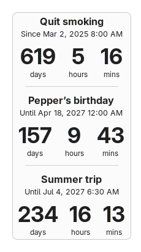

# Milestones

A [Cinnamon](https://github.com/linuxmint/cinnamon) desklet that counts the days, hours and minutes since or until the dates that matter to you. One desklet holds several trackers, and monthly or yearly repeats handle birthdays and anniversaries. It sets no colors of its own, so it follows your Cinnamon theme.



The desklet's own documentation is in [milestones@CyberJody/README.md](milestones@CyberJody/README.md).

## Install

Once it is published on [Cinnamon Spices](https://cinnamon-spices.linuxmint.com/desklets), install it from **System Settings → Desklets → Download**.

To install from this repository:

```bash
git clone https://github.com/CyberJody/cinnamon-milestones.git
ln -s "$PWD/cinnamon-milestones/milestones@CyberJody/files/milestones@CyberJody" \
      ~/.local/share/cinnamon/desklets/milestones@CyberJody
```

Then right-click the desktop → **Add Desklets** and add **Milestones**.

## Layout

The folder `milestones@CyberJody/` uses the [Cinnamon Spices](https://github.com/linuxmint/cinnamon-spices-desklets) layout: `files/milestones@CyberJody/` is what Cinnamon installs, and `info.json`, `README.md` and `screenshot.png` are used by the Spices website.

| File | Purpose |
|---|---|
| `desklet.js` | The desklet: counting, repeats, display |
| `TrackerEditor.py` | The tracker table and editor in the settings window (calendar, time fields) |
| `settings-schema.json` | Settings window layout |
| `stylesheet.css` | Spacing and sizes only; colors come from the theme |
| `tests/test_tracker_editor.py` | Checks for the tracker editor |

## Tests

The editor tests run without opening a window. They need PyGObject and `python-xapp`, which come with Cinnamon, so use the system Python:

```bash
/usr/bin/python3 tests/test_tracker_editor.py
```

## License

GPL-2.0, the license used by the Cinnamon Spices repository. See [LICENSE](LICENSE).
